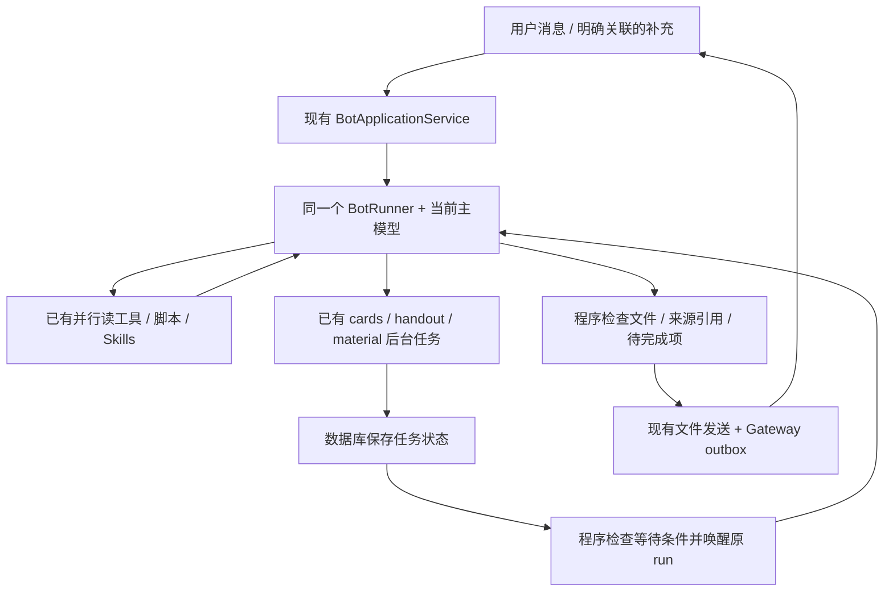

# Wangke Bot 落地方案：单代理优先与可靠任务接续

## Steps

- [x] R1：定义最小输入/等待状态，支持明确关联的运行中补充和澄清回答。
- [x] R2：为现有后台学习任务增加持久化等待与程序唤醒。
- [x] R3：完善产物检查、完成条件和必要的状态展示。
- [ ] R4：完成行为回归和同模型成本/效果对照，再决定是否试验通用委派。

> 2026-11-01：用户已要求按此设计理念出落地方案，并交给 **gpt-6.1-sol（`dstu/gpt-6.1-sol`）** 实施。执行范围为 R1–R4；第 11 节补全交接规格与验收，第 5 节通用子代理仍为后续实验。此前 A–G 已被本文替代；旧源码调研保存在 [归档](bot-superagent-source-study-v1.md)，其实施提示词不再适用。本次交接前仅完成源码研究与规划，尚无应用实现或实测收益。

## 1. 重新审视后的结论

**默认让现有一个 Bot 把工作做完；把可靠接续、等待和交付做扎实。子代理是有收益时才引入的工具。**

旧方案的几个问题：

1. 把“长任务”默认变成“协调者 → 执行者”，即使只有一个执行者也增加了交接。
2. 用“多份资料”作为分工示例，却没有证明现有批量读工具、脚本处理和单代理上下文不足。
3. 将运行中接收要求、后台完成唤醒、验证文件与多代理绑在一起；前面三项完全可以独立实现。
4. 在验证收益前，预设了 WorkItem、Assignment、Report、Effects 等整套新状态模型和界面。

DSH 面向团队 GitHub/飞书的多个并行工单，长期主路由角色有其场景。Wangke 当前主要是个人 Bot，不能仅因为参考项目有协调者就照搬。

### 模型、代理和调用次数是三回事

- **一个模型**可以被多个代理重复调用，账单和延迟仍会增长。
- **一个代理**可以多轮调用同一模型、并行用工具、执行很长的任务；单代理不等于一问一答。
- 模型数量不直接决定效果；要看总请求、输入/输出 token、上下文重复、工具成本、耗时与完成质量。
- 现有读图/学习生成工具可能需要视觉或生成模型，继续按任务需要使用。单代理优先指的是不凭空添加负责路由、监督、审查的模型循环。

## 2. 任务怎样选择执行方式

| 任务 | 默认方式 | 原因 |
| --- | --- | --- |
| 问答、解释、润色 | 当前 Bot 直接处理 | 多一次派工通常没有价值 |
| 比较若干文件、搜索几个网页 | 同一个 Bot + 独立读工具并行 | 当前已有最多 4 个安全读工具并发；读文件不一定要模型 |
| 整理 CSV、重命名、转换格式 | 同一个 Bot 编排脚本/工具 | 数据处理和校验适合确定性程序，不按文件开代理 |
| 长篇报告、反复修改同一文档 | 同一个 Bot 分阶段推进、使用现有 checkpoint | 共享上下文多，拆开可能丢约束并增加交接 |
| 等待讲义/卡片/材料生成 | 原 Bot 挂起，程序发现终态后唤醒 | 等待本身不需要模型理解 |
| 几条耗时且彼此独立的深入调查 | 先用单代理基线；有证据再试少量委派 | 需要比较并行节约的时间与派工/汇总成本 |
| 复核重要结论 | 先查原始证据、跑确定性检查；必要时再独立复核 | 多个同模型回答一致，不构成独立事实证明 |

文件多、token 多、步骤多、任务耗时长，都不是自动创建子代理的充分条件。

## 3. 修订后的首版架构



程序负责去重、关联、状态、等待、重启恢复和结构检查；当前 Bot 负责理解要求、选择工具和组织答案。首版没有新增的路由模型、常驻协调模型或固定审查模型。

现有 `runs / run_steps / messages / cloud_tasks / cloud_task_events / bot_operations` 足以承载大部分基础。优先给 run 增加必要元数据和少量输入/等待关联记录；具体迁移由 R1 核实后冻结。**不以未来多代理为由提前建立旧版六张领域表、通用 DAG 或全新派工队列。**

## 4. 首版保留的三个具体改进

### 4.1 同一次执行能够接收补充、等待回答

源码现状：`agent/service.ts:58–66` 每条新消息插入 run；`runner.ts:203–208` 初始历史截至触发消息；普通 `question` 在 `runner.ts:750–758` 结束 run，而审批已有等待恢复流程。

实施要求：

- 首先支持明确关联：Web 传入目标 run/问题引用，或 `replyTo` 能唯一映射原执行。IM 只使用实际可用且已映射的引用/问题身份，不假设平台必定提供引用字段。
- 没有可靠关联的新消息保留当前队列语义。**不增加一个模型预先判断每句话属于哪个任务。** 自然语言自动关联若确有需求，另做效果实验；可复用主 Bot 的正常轮次，但需验证误关联和额外调用。
- 关联消息原文继续写入现有 messages，新增持久化消费记录；唯一归属防止既追加到旧 run 又创建重复 run。
- 在下一安全模型/工具边界读入补充；消费标记与采用它的 context 一起保存。原始附件、要求和来源可回读。
- 若刚生成的工具批次已被补充要求改变，完整记录未执行结果后重规划，保持三协议工具调用/结果配对。已经发生的外部操作按现有取消与不确定态处理。
- 对需要继续工作的澄清，保存明确的问题 ID 和等待原因，回答后续接原 run；审批与普通澄清不能共用模糊的“最近一个等待项”。
- `stop` 阻止后续执行和晚到结果复活；用户后来明确请求继续，记录新的恢复行为并复核当前状态。

这改善的是执行连续性。现有 Bot 已经能继承上一轮上下文，不应把此项宣传成“第一次拥有多轮记忆”。

### 4.2 后台任务完成，由程序唤醒

源码现状：`study_task` 已支持创建/查状态/取消，限于三个课程任务类型；工具说明建议 `wait → status`。`runner.ts:739–742` 持久化定时唤醒，`syncChildren():898–910` 将终态记作 progress。当前 wait 睡眠期间不调用模型，优化对象是醒来检查时的重复模型轮次。

最小实现建议：

1. 扩展现有 `study_task`，增加等待指定任务结果的操作；首版面向已有学习任务，不提供通用 `spawn`。
2. 保存父 run、子 task IDs、等待条件和消费标记；需要结果的任务集合明确记录。先支持全部完成即可，不必预建任意依赖图。
3. 父 run 进入明确的事件等待状态并退出执行循环，释放活跃槽位；注册等待的工具结果完整持久化。
4. 调度器依据数据库终态推进等待。现有每秒 tick 可以做恢复/检查，完成后立即调度可作优化；**代码检查状态不消耗模型 token**。
5. 在同一事务中完成“等待条件满足、结果引用入上下文/待消费记录、父 run 重新 queued”。不用不可靠的进程 hook 承担唯一唤醒责任。
6. 注册等待时也检查已经完成的任务，避免完成早于等待造成永远挂起。重启重扫、重复终态均只产生一次逻辑恢复。

新增等待状态必须同时更新 DTO、调度筛选、取消/归档/重启恢复和 `UsageLedger.checkAdmission`：父 run 等待期间，关联学习任务仍应能合法调用其模型；停止/撤权后则不能。

父仍使用原 run，现有学习请求继续通过 `parent_run_id` 计入它的账本，不为了唤醒重建执行或重置额度。已经不确定的 shell 租约必须等 broker 确认清理，不能随逻辑等待提前释放。

### 4.3 用已有证据交付，优先程序验证

- 文件存在、归属、格式可解析、大小、注册 fileId、任务终态、来源 revision 等可机器检查的条件，用代码检查。
- 回复若承诺生成成果，必须对应真实产物；失败部分明确说明。后台任务“已排队”不能当作成果“已完成”。
- 仅把本次承诺所必需的待完成项作为结束条件；用户明确要求仅启动后台工作/设置提醒时，允许先回复已启动，不能无限阻塞正常聊天。
- 事实准确性/文档质量仍由当前 Bot 使用原始资料核验，需要时使用任务特定评测；不固定增加审查代理。
- 沿用 `study_upload_file → study_send_file` 和 Gateway outbox；结果生成与渠道送达仍是不同事实，投递失败只恢复投递。
- UI 最小调整：准确显示执行中、等回答、等后台结果和产物；问题/引用关联接入现有聊天。首版不建多代理树和调度驾驶舱。
- 仅修改必要的提示词和工具说明，暂不为组织形式拆出多套角色 prompt 或模型设置页面。

## 5. 通用子代理何时值得引入

保留为后续小范围实验，默认路径不启用。满足下列实际条件才值得试：

- 子目标足够独立，不需要频繁交换共享上下文或同时修改相同产物。
- 子工作需要独立的多轮推理/调查，普通并行工具或脚本不能解决主要瓶颈。
- 每个子任务能交付精炼、可验证的结论与来源，不必把全部过程复制回父上下文。
- 有可测量的目标：明显减少关键路径耗时，或改善已确认的遗漏/质量问题。
- 相对单代理基线，派工、上下文重复、子执行、汇总和复核的总成本可接受。

用户明确要求多人独立调查/复核，也是选择该路径的理由，但仍需记录真实成本与收益。**依据任务结构和证据决定，不使用“复杂”这个模糊标签自动升级。**

实验应由当前 Bot 在已有正常轮次选择委派工具，不另加常驻分流模型；按需要从一个有明确收益的辅助任务开始，不固定“主 + 两子 + 审查”。验证有效后再决定并发上限和是否需要 WorkItem / Assignment。

如果进入该阶段，旧研究里有价值的约束仍须满足：派工和结果持久化、原始需求引用、父子用量累计、取消级联、旧代次拒绝、工具/资源范围验证、独立上下文、结果统一交付。共享目录继续单写者；子目录名和提示词不是任意 shell 的隔离边界。实现必须重新立项设计，不能直接执行归档 A–G。

## 6. 数据与兼容性边界

- R1 先确认最少需要的 run 元数据、输入消费和后台等待关联，记录状态转换；后续包复用同一契约。必要的关联记录可以用小表实现，不能为了减少表数把并发事务和来源追踪做丢。
- 新输入归属要在事务里复核 run 是否已结束；不能在检查后竞态地把消息追加到终态执行。终态后的正常跟进仍可新建 run 并复用现有上下文，无需强行复活原执行。
- 新等待条件和 context 水位跨重启保存；未确定的外部副作用先查证据，不盲目重做。
- 复用模型客户端、当前模型配置、原子用量预留、未知 usage reservation、Skills、记忆、checkpoint 哈希和同账号/会话读取范围。
- `/system` 读取/新建/修改/安装技能沿用免审批规则；删除仍需精确单次确认；显式 deny、网络、归档、账号与项目边界继续生效。
- 既有 shell 工作区锁和 broker 租约保持；首版无须放宽同工作区多 run 互斥。
- 保留消息/文件幂等、Gateway 绑定/游标、审批归属和发送 `uncertain` 状态；不承诺外部 exactly-once。
- 保留普通文字/emoji 直答和既有课程问答入口；不恢复手动“继续任务”和独立预算表单。
- 按实施时数据库真实布局追加迁移，保留历史布局校验，不按旧文档重编号。停用新准入后要结算已等待任务；功能开关回退不等于旧二进制兼容新 schema。

## 7. 收敛后的实施包

### R1：输入关联与等待状态

**文件**：`agent/service.ts`、`agent/runner.ts`、必要的 routes/contracts 和 `storage/database.ts`。

交付最小输入/等待契约、数据库迁移、明确的补充消息关联、澄清问题身份与消费水位。也先定义 R2 的等待字段，避免两包争抢迁移。覆盖停止、归档、重启、终态竞态和原审批恢复。

### R2：现有后台任务自动接续

**文件**：`agent/study.ts`、`agent/runner.ts`、`cloud/tasks.ts`、`agent/budget.ts` 按实际需求修改。

在 R1 契约上实现任务等待、结果消费、数据库驱动唤醒；维护学习任务模型请求的父 run 归属。核验完成先于 wait、事务前后崩溃、重复通知、取消后的迟到结果。没有新增路由模型调用。

### R3：交付条件与最小展示

**文件**：runner 完成条件与现有文件工具；`BotWorkspace.tsx`、`serverClient.ts`、必要的文案/状态 DTO。

代码检查可检验条件，补必要工具说明。让用户可以关联补充/回答并看懂等待状态，区分结果与投递失败。普通聊天无新代理或额外分类步骤。

### R4：回归与同模型对照

**文件**：有意义的行为回归脚本、`scripts/eval-bot.mjs` 的相关场景和统计、运行文档。

R1 → R2 → R3 接续实现，R4 的夹具可提前准备。保持一个人/代理负责 runner 集成和迁移；无需为了开发这次功能也强制开多个子代理。若以后安排开发子代理，其作用是分工写代码，与产品每次运行是否多代理是两回事。

## 8. 验收：能力改善且不引入固定调用税

### 软件行为

1. 原普通文本/emoji、三协议工具批次、附件/读图、记忆/Skills 行为通过。
2. 同一关联消息只进入一个执行，消费一次；取消/归档/终态竞态无丢消息或复活。
3. 无关联消息仍正常排队；不会全靠关键词绑定或被后台分类器处理。
4. 澄清回答与审批精确匹配，两个等待项不会串线。
5. 后台任务完成早于 wait、失败、重复终态和重启，都能正确结算；无需反复醒来问模型任务好没好。
6. 事件等待期间不占活跃执行槽，关联学习任务可继续；取消后无新模型准入、晚写或发送。
7. 父 Bot 不为轮询等待状态发起模型请求；程序 tick 不计作模型调用。后台学习任务自身的生成请求仍正常计费并计入父 run。
8. 文件不真实或必需任务失败时不能声称交付成功；只启动后台工作不会被错误阻塞。
9. 用量不因恢复而重置；未知用量继续预留；发送失败不重生成文件；所有权与现有锁有效。

按变更运行 `test:bot`、`test:tool-parallel`、`test:bot:hardening`、`test:memory-context`、`test:gateway`、`test:migration` 和构建；UI/资源/MCP/broker 被触及时追加相应检查，命令以当时 package.json 为准。确定性回归可以验证固定调用路径与状态机，不能代替真实质量测量。

### 成本与效果

用同模型、同输入、同工具和可比配置，对照当前 Bot 与单代理修订版；包含普通聊天、多文件比较、长文修改、澄清、等待学习任务、中断恢复。记录实际请求数、输入/输出/cache token、费用已知覆盖率、耗时 p50/p95、可用完成率、人工干预和重复交付。

默认路径不得增加专用分类、派工或审查模型调用。用户新增要求导致的必要重规划、视觉/领域生成请求和实际失败重试单独归因，不能笼统声称总调用数恒定。

只有单代理基线暴露明确瓶颈，才建立可选委派对照组；把父/子/汇总所有请求纳入统计，不只报告并行阶段耗时。共享前缀缓存可能减少费用，但必须读实际 usage，不能预设命中。

首版优先验收约束正确、续接可靠和无固定调用税；速度、费用或质量提升以实测为准。

## 9. 交给实施代理的最新指令

```text
实施 docs/bot-superagent-roadmap.md 的单代理优先修订版 R1–R4。
用户已要求由 dstu/gpt-6.1-sol 实施；完整阅读本文，尤其第 11 节交接规格，直接开始 R1。
先核对当前 HEAD、相关 AGENTS.md、源码和真实数据库布局。
默认复用同一个 BotRunner/主模型：现有并行工具处理读取，脚本处理确定性工作。
先实现明确关联的运行中输入/澄清、已有学习任务持久化等待与程序唤醒，
再补产物/完成条件和最小状态 UI，最后做行为及同模型调用成本对照。
按第 6 节兼容性边界和第 8 节验收执行；完成一项同步勾选本文与项目计划。
此版取代旧 A–G。通用子代理、常驻协调/分流/审查模型、六张领域表和
多代理看板不属于首版；若发现单代理瓶颈，提交证据与最小实验设计再评估。
不要把用户新的要求、必要视觉/生成或失败重试产生的调用伪称为零成本。
```

## 10. 源码依据

本轮重新核实的核心代码仍为 Wangke `4c1e5e4b881c61e1c90764254e728148eb28982c`；工作区其他正在进行的 Gateway/UI 修改未纳入本次编辑。DSH 调研固定于 `6337fc823ce20251c8de8085948165c81aaa701e`。

- 当前执行/输入：`apps/api/src/agent/runner.ts`、`agent/service.ts`。
- 已有并行：`packages/study-core/src/utils/toolBatch.ts`。
- 学习任务/模型归属：`agent/study.ts`、`cloud/tasks.ts`、`agent/budget.ts`。
- 生命周期 hook 为 best-effort：`agent/events.ts`；可靠等待须有数据库事实支持。
- DSH 可借鉴的部分：`src/core/assignments.ts` 的输入消费/恢复；`src/app/effects.ts` 的持久化和代次；`src/core/replies.ts` 的交付归属；`docs/000-philosophy.md` 的低打扰原则。
- 固定提交链接和更完整源码对照见 [源码调研归档的证据索引](bot-superagent-source-study-v1.md#11-源码证据索引)。上游研究原型的事实与本方案新增设计分开看待。

## 11. 给 gpt-6.1-sol 的实施交接规格

### 11.1 工作目标与开发起点

把 DeepSeek 的五项经验落实为现有 Bot 的行为：原始需求可回读、追加消息确实进入执行上下文、状态先保存再推进、交付事实明确、只在有结果或需要决定时打扰用户。采用其设计原则，按当前项目代码适配，不依赖安装 DeepSeek Harness。

实施顺序为 R1 → R2 → R3 → R4。由一个实施会话负责数据库/contracts/runner 集成，使用现有模块或增加小型输入、等待模块，避免继续扩大 runner 的内联分支。研究归档只作证据，不能混入旧 A–G 的多代理范围。

开始时记录 HEAD、`git status --short` 和准备触及文件的已有差异。交接时主目录 main 有其他会话的 Gateway、UI、文档和脚本未提交改动，尤其 `apps/api/src/gateway/core.ts` 与 Gateway 回归；必须逐段接续，发现内容变化先重读。数据库回归使用临时数据目录。当前授权是本地实施和验证；发布、生产迁移与真实渠道外发另行安排。

### 11.2 R1：输入与问题的最小契约

**API 入口**：实际消息入口在 `apps/api/src/server.ts` 调用 `BotApplicationService.send()`；同步修改 Web `serverClient.ts`、共享 contracts 和 Gateway 的调用方，避免仅改 `agent/routes.ts` 而接口不生效。

以下类型为语义建议，命名可适配项目；字段必须在服务端校验，不能直接信任前端传来的归属：

```ts
type BotInputTarget =
  | { kind: 'run'; runId: string }
  | { kind: 'question'; questionId: string };

// 扩展现有 send 输入：clientNonce / kind / content / replyTo 保留。
// target 缺省保留旧语义；replyTo 仅在能可靠映射执行或问题时参与关联。
type BotInputReceipt = {
  messageId: string;
  runId: string;
  disposition: 'created' | 'appended' | 'answered';
};
```

1. 在同一事务中完成原始消息保存、去重和唯一执行归属。相同 clientNonce 重试返回原归属，不能另建 run；身份字段冲突不得把已存在消息改投别处。保留旧响应字段，新增 receipt 元数据或通过既有状态接口查询。
2. 只允许同 owner、同 thread、有效资源范围内的关联。`replyTo` 是引用不等于授权；若同时传 target，必须核验二者相容。普通引用无法映射时仍按原行为处理。
3. 显式 target 在发送前已终结时返回可识别的过期目标错误，Web 保留草稿，清除关联后由用户正常发送。无显式 target 的普通后续消息仍可新建 run。禁止将停止的 run 自动复活，也禁止静默丢弃消息。
4. 最小持久化事实：每条追加消息的原始 message ID、目标 run、顺序、入队时间、已纳入 context 的水位/版本；问题的稳定 ID、对应消息、run、待答/已答/已失效状态。可用小表与 run 元数据实现，R1 冻结具体 schema 和唯一键。
5. 保留 message 原文、附件 fileId/项目路径和原始顺序。上下文只增加来源/关联标签，不把用户原文改写成新需求；压缩后仍可按权限回读。`consumed` 只表示已进入可重放 context，不声称模型必然理解或遵从。
6. 消费在模型请求前、工具批次安全边界和最终交付前检查。消息到达正在执行的 run 时只持久化，由原执行接收；不能并发再启动同一 run。模型请求期间新增要求，返回后先检查输入版本，再决定是否执行已生成动作。
7. 若需中止尚未执行的工具调用，保存明确的未执行结果并保持三协议工具对完整；已经执行的工具结果保留。输入消费标记和 context 一起提交，重启后不重复注入、不漏输入。
8. 普通澄清可沿用 `waiting_user`，但必须区分 `question` 与 `approval`。问题回答只解除该问题，绝不批准工具操作；修改现有审批“最近 waiting_user”兼容分支时保留旧审批身份校验。重复回答、过期问题、停止后的回答均有确定结果。
9. 允许无关的独立请求继续排队运行；一个澄清等待不能占住全局活跃槽位。等待中的追加消息、后台结果与审批同时出现时，通过状态/版本比较决定唤醒，不覆盖尚未解除的等待原因。

**R1 出口**：通过真实 service/runner 的模拟模型测试，验证运行中补充在后续模型请求可见、原 run 接续且无重复执行；旧客户端/无关联消息/原审批回归通过。

### 11.3 R2：等待已有学习任务，不让模型查钟

建议为 `study_task` 增加 `action: 'wait'` 与 `taskIds`；保留旧 create/status/cancel。等待操作是串行屏障，不能标记 `parallelSafe`。

- 首版 wait 只接收当前 owner、当前父 run 创建的任务；跨 run/账号不接受。taskIds 去重、有界，调用合法性在事务内复核。
- 为每次等待生成稳定 ID/版本，记录父 run、目标任务集合和完成消费状态。全部任务进入终态时结算；失败或取消也是终态，不允许只等成功而永远挂起。
- 已全部终结的 wait 直接返回真实状态和结果引用，无需额外挂起。其余情况先保存 wait 工具结果、context 和等待状态，再退出 runner；禁止先标记等待、后补工具结果。
- 父 run 采用 `waiting_event` 或语义等价的显式状态，由 R1 冻结。数据库扫描恢复等待；进程通知仅缩短延迟。结果已落库但唤醒尚未完成时，下一次扫描可恢复。
- 同一事务内校验等待版本、父 run 仍可推进、子任务终态与权限，写入一次结果待消费记录并转换状态。若父 run 因用户补充已经重新运行，仅追加待消费结果，由现有执行处理，不再启动第二份。
- 用户在等待期间补充要求时，原 wait 记录保留到明确结算或替代；旧 wait 的晚到结果不得解除新问题/审批或覆盖新等待。停止后取消关联工作并拒绝新模型准入，清理确认前保持 shell 租约。
- 结果携带 taskId、真实 status、结果/文件引用或错误；完整内容沿用受控回读，避免无界注入。后台任务 `waiting_user` 应接通现有审批显示，不误当作终态。
- `UsageLedger.checkAdmission` 对合法 study 请求接受新增等待状态；`settle()` 超额时也覆盖新增状态。父恢复沿用原账本，取消/撤权后拒绝新增请求。
- 遍历所有状态读写位置：service、runner、server SSE、contracts、Gateway 健康/状态、Web、停止/归档/撤权、发布 drain/recover。事件等待是正常工作状态，不能自动显示成故障。

**R2 出口**：完成早于 wait、注册后完成、失败、取消、重复扫描、关键事务前后重启、等待中追加消息都能正确推进；父 Bot 为等待轮询发起的模型请求为零，领域生成请求仍完整记账。

### 11.4 R3：完成条件、原始证据与低打扰交付

完成条件依赖结构化事实，不尝试用关键词或另一个模型从每条聊天提取验收清单。

1. 在 `study_task.create` 明确记录 `completionMode: 'await_result' | 'background'`（名称可调整）。新任务默认等待其承诺结果；只有用户明确仅要求启动后台工作时才使用 background，并告知启动状态。迁移前遗留任务按兼容规则处理，不能把所有历史子任务自动变成阻塞项。
2. 对 wait 声明的必需任务保存集合。未结算时不能走“已完成”的出口；发生失败时允许交付真实的失败/部分成果说明，避免失败后永远无法结束。
3. 完成检查覆盖无工具直接回答、`send_message` 默认 complete、`finish_turn` 等全部终结路径。检查针对本次有结构化依赖/产物的执行；普通问答仍直接完成。
4. 产物注册/发送先核验所有权、存在性、可读性和支持格式的基本结构，复用现有文件工具。来源引用可回读不等于语义正确；内容质量通过主 Bot 和任务评测核验，不承诺通用事实验证。
5. 清楚区分本地消息保存、文件已注册、已进入 outbox、已送达/失败/uncertain。工具文案不能把本地保存描述成 IM 已送达；投递失败复用同一产物和现有幂等标识，不再生成一次。
6. 最终交付前再检查输入水位与等待版本；用户的新要求若先被服务器接受，不得随后按旧要求宣告完成。已经完成的外部发送不能撤回，保存事实并处理后续要求。
7. 工具日志、普通重试、内部等待记录保留内部；向用户发送可用结果、具体决策问题或真正阻塞说明。不要每个内部状态变化都创建一条聊天消息。
8. Web 在现有聊天内提供轻量引用/补充对象和问题回答入口，携带 target 并保留附件/草稿/重试。只展示正在处理、等回答、等后台结果等必要状态，沿用现有视觉和 i18n，不重构聊天布局。
9. IM 仅采用渠道真实提供且完成本地映射的引用/问题标识。若某渠道无法关联，维持普通新消息语义并记录支持范围；不能把“当前只有一个任务”或“最近一条问题”自动当成关联证据。Web 与 IM 最终使用同一个 service 状态机。

**R3 出口**：原始资料可追溯、已排队不冒充已完成、必需任务失败能正确说明、明确后台启动可先回复、重复投递不生成重复成果；Web 桌面/移动端补充与回答实际可用。

### 11.5 R4：验收场景和实测报告

新增有行为意义的回归，优先扩展现有 runner/service 测试与受控模型夹具，必要时增加 `scripts/test-bot-continuity.mjs` 并挂入 package scripts。要求断言数据库事实、实际模型请求输入和用户可见结果，不只断言新函数返回值。

必须覆盖以下端到端链路：

| 场景 | 可观察的通过条件 |
| --- | --- |
| 分析十份资料，中途明确补充只分析前三份 | 下一安全边界采用原文；未开始的旧动作被跳过；同一 run 继续 |
| Bot 提问输出格式，用户针对问题回答 | 精确恢复原 run；不会创建审批或批准已有审批 |
| 创建讲义任务并等待 | 父执行退出活跃槽位；任务继续计费执行；完成结果驱动接续 |
| 完成早于 wait / 失败 / 重复终态 | 正确返回各自事实；一次逻辑恢复，没有永久等待 |
| 输入保存后重启 / 结果保存后重启 | 不漏读补充、不重复工具副作用、不丢失唤醒 |
| 等待中补充后再创建新等待 | 旧等待的结果不覆盖当前状态、不启动第二份 run |
| 用户停止后子任务晚到 | 无父 run 复活、无后续外发或新模型调用 |
| 文件已生成但 IM 发送失败 | 只重试既有投递；uncertain 沿用既有处理 |
| 仅请求后台启动 / 普通文字或 emoji | 正确直答，无新增固定分类、派工或审查调用 |
| 越权 target / 重复 nonce / 终态与发送竞争 | 无跨会话读写、无重复归属、无静默丢消息 |

运行已确认存在的命令：

```sh
npm run test:bot
npm run test:bot:hardening
npm run test:tool-parallel
npm run test:memory-context
npm run test:tasks
npm run test:gateway
npm run test:gateway:chunking
npm run test:migration
npm run test:bot-ui
npm run test:bot-composer:e2e
npm run build
```

另按触及面运行 `test:projects`、`test:resources`、`test:system-files`、`test:release-drain`、`test:release-recovery`、`check:i18n`。需要浏览器服务或 Docker 的检查注明环境；已有失败应提供改动前后证据，不能删断言或将其写作通过。

在 `docs/bot-continuity-acceptance.md` 记录实现范围、schema/状态决策、准确命令和结果、截图路径、模型请求统计、未验证项目。`scripts/eval-bot.mjs` 扩展同模型比较场景，分别报告确定性执行正确性与真实模型质量。

真实模型评测沿用现有隔离配置、价格与费用授权要求；没有可用配置时先交付可运行评测入口和模拟调用统计，明确真实费用/质量待验，保留对应待办。不得用模拟结果声称真实降价/提质；R4 中未完成的真实对照在两份计划里继续标为未完成，并写明已完成的软件验收。

### 11.6 交接完成标准

- R1–R3 的功能与对应回归实际完成后，逐项勾选本文与项目计划 `c4276fae-20e7-4314-b53e-ece0dd74327e`，只修改对应进度和真实实施记录，不删约束。
- R4 按软件回归和真实模型对照分别报告完成程度；阻塞项记录具体原因，避免笼统写“全部完成”。
- 最终向用户说明可直接使用的新行为、验证结果和剩余环境验收；指出通用子代理仍属于后续收益实验。
- 先实现并验证上述闭环；如果发现确需额外结构才能保证一致性，在现有范围内解释并采用最小方案，而非恢复旧六表/常驻协调者架构。

### 11.7 本次实施记录（2026-11-01）

- R1 已实现：migration 29 增加 `run_inputs`、`run_questions`；`BotApplicationService.send()` 支持服务端核验的 run/question target、nonce 幂等、终态拒绝和 receipt；runner 在模型请求前及模型返回后的安全边界原子消费追加原文/附件引用。普通无 target 消息仍创建新 run，审批路径未复用问题表。
- R2 已实现：`study_task.wait(taskIds)` 仅接受当前 owner/父 run 的 cards/handout/material 任务；`run_waits` 持久化屏障，scheduler 数据库扫描终态（完成/失败/取消/中断）并一次性恢复原 run，更新已保存 tool result；`waiting_event` 已接入取消、账本准入和状态 DTO。
- R3 已完成复测：question/approval 在前台任务未完成时仍可见并分别进入 `waiting_user` 身份；异步工具期间的明确追加会在工具边界停止旧批次、保留已完成结果、记录未执行调用并消费后重新规划，旧回复不进入 messages/events。隔离 runner、服务、API/Playwright 和 390px/桌面验收通过；R4 真实模型对照仍待配置。
- R4 已完成确定性回归入口与软件回归的一部分；真实模型同模型成本/效果对照因未配置隔离模型及费用授权，保持待验，不用模拟模型结果代替。
