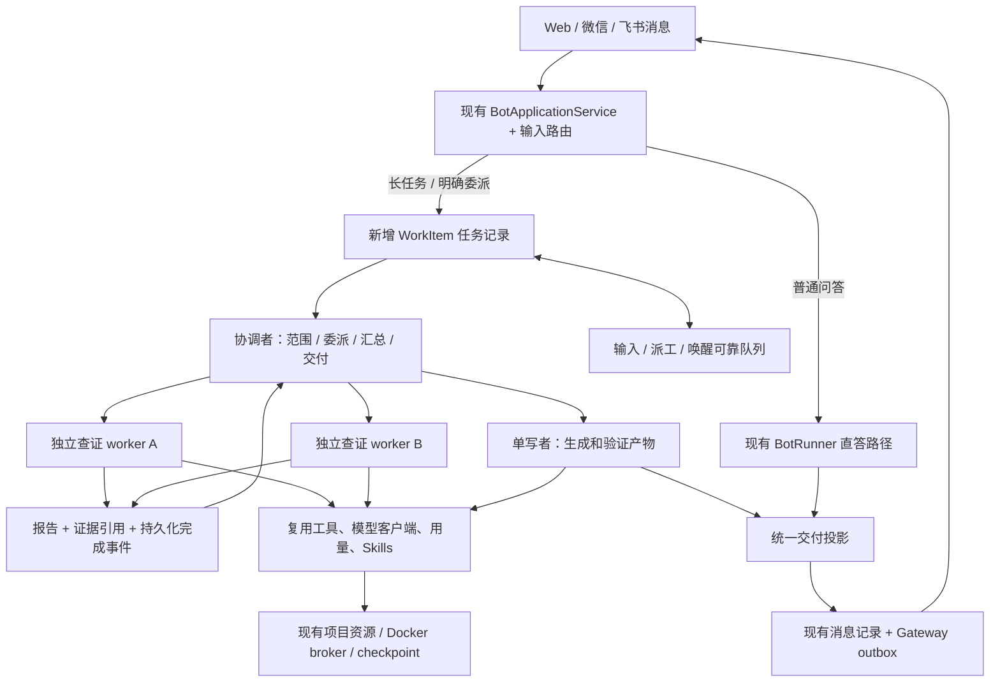
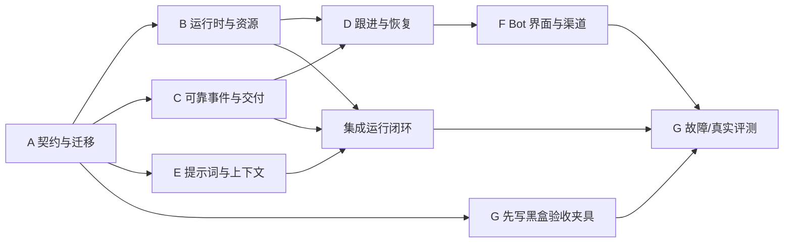

# Wangke / DSH 源码调研归档（旧方案已替代）

> **历史归档，不作为当前实施指令。** 2026-11-01 按用户反馈重新审视模型调用成本，原方案把通用多代理、协调者和完整任务领域模型过早列入首版。当前唯一实施入口是 [bot-superagent-roadmap.md](bot-superagent-roadmap.md)，采用单代理优先。
> 下文保留 2026-10-31 的源码研究及旧设计以便追溯。旧版步骤、架构、工具/表设计和实施提示词均已被新版替代；源码事实仍须对照实际 HEAD。

## 旧版实施包（已由新版范围替代）

- A：任务、委派、报告与输入契约及迁移。
- B：通用子代理与资源调度。
- C：持久化完成事件、等待/唤醒和统一结果投递。
- D：任务内追加消息、澄清回答、停止与恢复。
- E：角色提示词与上下文、直答路径和证据报告。
- F：Bot 任务详情与待答问题展示。
- G：故障回归、真实模型对照评测与分阶段启用。

> 原方案未实施。下文“首版”“建议”等措辞均属于旧版历史内容。
> 调研日期：2026-10-31。结论依据下面固定版本的源码、文档与测试用例；本轮未运行两项目的测试、真实模型或部署。

## 1. 结论先行

**推荐在现有 Bot 上增加轻量、持久化的任务编排层，复用现有执行器；将 dsh-superagent 的领域设计和执行约定移植过来。**

最重要的四项能力：

1. **任务跨多轮消息持续存在**：用户补充要求、回答问题后，回到同一个任务。
2. **可控的通用委派**：主 Bot 把独立调查交给子代理，接收结构化结果后统一交付。
3. **事件驱动的等待**：子任务完成时唤醒父任务，等待期间无需反复调用模型查询状态。
4. **交付有证据**：区分“生成了文字”“文件已验证”“已排队发送”“渠道已送达”。

你的项目已经有较完整的执行底座。主要差距在任务身份、角色分工和消息衔接，不需要重新实现模型客户端、记忆、工具调用或 IM Gateway。

### 调研版本

| 项目 | 固定提交 | 本轮依据 |
| --- | --- | --- |
| BA7MLV/wangke-agent | `4c1e5e4b881c61e1c90764254e728148eb28982c` | 本地 main 与 GitHub API 返回的 main 相同；调研开始时仅 `test-results/` 未跟踪 |
| deepseek-ai/dsh-superagent-prototype | `6337fc823ce20251c8de8085948165c81aaa701e` | 通过 GitHub API 下载固定提交的完整源码归档，检查 core、app、executor、prompts 及相关测试 |

DSH README 明确说明：这是面向单一 GitHub 仓库的研究原型，依赖 DeepSeek Harness，公开版与内部实现/文章并不完全一致。因此下文将“上游已有实现”“Wangke 已有能力”和“本方案新增设计”分开标注，不把研究目标当成可直接安装的能力。

## 2. 当前 Bot 的真实能力与缺口

| 维度 | Wangke 源码现状 | 改造判断 |
| --- | --- | --- |
| 主循环 | `BotRunner.execute()` 多轮模型/工具执行；SQLite 保存 run、steps、context；支持重启恢复 | 直接复用 |
| 工具并行 | `executeToolBatch()` 允许最多 4 个显式安全的独立读操作并发；写入与交互形成顺序屏障 | 已实现，工具并行不等于子代理并行 |
| 多任务调度 | `BOT_CONCURRENCY` 默认 1、上限 8；同 workspace 的活跃 run 互斥 | 增加 worker 后必须处理槽位与工作区锁，调高参数本身不够 |
| 子任务 | `study_task` 仅创建 `cards / handout / material`，绑定课程；`CloudTaskRunner` 有专用执行器 | 保留为领域任务适配器；另加通用 Agent 委派 |
| 等待 | `wait(seconds)` 持久化定时唤醒；工具说明要求 `wait → study_task status` | 新增按结果事件唤醒，减少模型轮询 |
| 新消息 | `BotApplicationService.send()` 每条新消息插入一个 queued run；已有 run 的初始历史受触发消息 seq 限制 | 增加任务内输入队列和明确关联，处理进行中的补充要求 |
| 子任务回传 | `syncChildren()` 将终态投影为隐藏 progress，当前没有通用父任务 join 语义 | 增加持久化报告与父任务唤醒 |
| 完成判断 | 无工具的正常回复可以结束 run；`finish_turn` 检查已发送回复/文件 | 保留普通聊天；复杂任务增加交付契约，run 完成不直接等于整个工作完成 |
| 上下文/记忆 | 72% 容量触发治理；保留系统指令、最新请求和完整工具对；checkpoint 可回读；系统文件/记忆有修订与来源 | 继续复用，新增按任务/角色裁剪，不另起向量记忆工程 |
| 技能与模型 | Skills 元数据先注入、正文按需加载；三种模型协议、重试和用量账本已有 | 复用，不要求换模型或引入新 SDK |
| 执行边界 | Docker broker、项目执行租约、权限复核、文件注册、取消清理已有 | 子代理进入同一套约束 |
| 消息投递 | Gateway 已有 inbox/outbox、去重、重试、发送不确定态；工具消息有 nonce | 扩展任务归属和交付状态，复用渠道队列 |
| 生命周期事件 | `publishBotEvent()` 是审计/观察接口，hook 异步 best-effort | 不能直接拿它承载“必须执行”的父任务唤醒 |

源码锚点：W1–W9，见文末。部分历史文档仍写“工具串行”或旧默认容量，本方案以当前代码为准。

### 一项需要在实施时核实的现有矛盾

`runner.ts` 的主提示词称课程内容不自动出现在这个聊天，但 `server.ts` 当前完整注册了 `StudyTools`，包括 `study_read / study_task`。因此不能简单判定 Bot “没有课程工具”，也不能在产品侧承诺它已经理解当前课程。应明确：工具实际可用范围、用户选定课程和 worker 的资源范围如何对齐；用专门用例确认。

## 3. DSH 真正值得借鉴的实践

### 3.1 任务与一次执行分离：Ticket / Assignment

**上游已有**：`core/engine.ts`、`tickets.ts`、`assignments.ts` 分离任务、执行绑定和执行报告；任务能经历多次 Assignment，重启或重试仍保留原任务。

**映射到 Wangke**：增加 `WorkItem` 表示用户要完成的工作，继续用 `runs / run_steps` 表示每次执行。用户问“刚才那个再补一页”时，可以找到原任务、原产物和约束。

这里的 WorkItem 是 Bot 的任务记录，不是项目的开发待办列表，也不是每条普通聊天都必须建立的大工单。

### 3.2 主角色与执行角色分工

**上游已有**：主 Session 负责接单、路由和结果转达，worker 读原始需求、实现和验证；`prompts/dispatch.md` 禁止路由者改写需求或擅自补设计；DSH worker 的更底层子代理依赖 Harness 提供。

**Wangke 适配**：

- 简单问答仍由当前 Bot 一次完成。
- 长任务采用“协调者 → 一个执行者”；只有任务确实独立时，执行者/协调者才创建并行调查子任务。
- 独立校验按任务需要启用，不为每句话固定创建 planner / worker / reviewer 三个角色。
- 路由信息携带原始 message ID、附件引用和显式约束，不能只有模型改写的摘要。

**本方案新增**：研究/生成/校验的 worker 划分、有限任务依赖和结构化 evidence 是针对 Wangke 的设计，不能说成 DSH 已自带完整通用 DAG 或学习代理框架。

### 3.3 先保存状态和待执行动作，再调用执行器

**上游已有**：`app/effects.ts` 的 SQLite 队列在事务里持久化 launch / delivery / relay / reply；任务执行在事务后进行。`seq + generation` 防止旧请求完成后删除更新过的队列项，`Later` 区分“暂时没槽位”与真正失败。

**Wangke 适配**：工作状态更新、子报告和父唤醒意图原子落库；重启后补发。内部可靠事件与现有 best-effort 审计 hooks 分开。外部消息仍进入现有 Gateway outbox。

### 3.4 区分“送到队列”和“模型实际读到”

**上游已有**：`inputsDelivered / inputsRead / turnEnded` 分别记录输入投递、进入 Session 和后续执行；取消/重启时重新分配未读输入。

**Wangke 适配**：用户运行中补充“只处理前两份”，应在下一个安全执行边界读到。不能仅因为消息已写入聊天记录，就把它当成当前执行已经采用。

### 3.5 结构化状态与单一交付者

**上游已有**：`orchestrator_report` 的状态、`human_action` 与问题来源明确；`core/replies.ts` 区分 acknowledgement / answer / result / attention，并验证路由和幂等身份。`core/stage.ts` 从事实计算“需要人工/工作中/等待/结束”。

**Wangke 适配**：worker 内部报告，主 Bot 统一发送结果与具体问题。UI 不从一段摘要猜测是否完成；避免父子代理分别发一份相同结果。

注意：上游 `ready` 的质量要求主要来自提示词，不是能证明事实正确的通用验证器。Wangke 仍需把“证据存在”和“内容质量”分开检验。

### 3.6 提示词模块化和版本记录

**上游已有**：`app/prompts.ts` 按角色组装固定部分、团队偏好和动态策略；覆盖记录基线版本；`role-models.ts` 在新 Session 初始化角色模型，不覆盖全局模型。

**Wangke 适配**：拆开 `runner.ts` 大字符串中的共同约束、沟通、委派、执行、交付部分；保存 prompt hash。复用 `/system/AGENTS.md` 与 Skills；动态信息保持稳定位置，延续当前缓存治理。

首版全部角色继承当前主模型即可。不同角色选不同模型作为后续实验，不能预先承诺便宜模型路由一定降低总成本。

### 3.7 事件来源与任务订阅

**上游已有**：Source → Trigger → Thread → Ticket，支持 GitHub/飞书事件、显式关联、context-only 订阅和 worker 退回不相关请求。

**Wangke 适配**：首版处理用户消息、子任务完成、明确设置的提醒/定时事件。后续再接“资料导入完成、讲义生成完成、用户指定的周期检查”等业务事件。

个人微信 Bot 的一条会话经常包含不同任务，因此不能直接照搬“订阅整个 Thread 后全部推给所有 worker”。应先使用显式 replyTo、taskId 或唯一待答问题关联。

## 4. 建议架构



### 推荐的首版范围

- 允许一个任务委派独立读/研究工作；建议初始最多 2 个并行 worker、嵌套深度 1。数字是待评测的工程起点，不是上游标准。
- 所有模型请求复用 `ModelClient / UsageLedger`，沿用三种协议。
- 保持共享工作区单写者；生成和发布由主执行者串行完成。
- 父任务等待子结果时释放活跃槽位和非必要工作区占用。
- 子任务完成自动唤醒父任务，用户补充要求能投递到原任务。
- Web 展示简洁任务详情；微信/飞书收到结果、必要问题和当前已有的少量进度里程碑。

**首版成功示例**：“对比三份资料，生成带来源的 Markdown 总结。”三个查证子任务按并发限额运行，协调者收齐报告，单写者生成并检查文件，再通过现有附件流程交付；过程中用户可补充格式，重启后继续原任务。

## 5. 实施契约：必须先定清的接口

以下名称为建议的新接口，当前项目中尚不存在。A 阶段可按仓库风格调整命名，但必须保留语义。

### 5.1 最小数据模型

| 记录 | 核心内容 | 约束 |
| --- | --- | --- |
| `bot_work_items` | owner、originThread、originMessage、目标原文引用、范围、revision、state | 用户工作单元；状态建议 open / completed / failed / stopped；waiting/needs_input 为事实投影 |
| `bot_assignments` | workId、parentAssignmentId、runId、role、generation、resourceScope、status | 绑定已有 run；区分协调者/worker、重试代次；旧报告不能结算新代次 |
| `bot_inputs` | workId、sourceType/sourceId、内容/附件引用、seq、delivered/consumed 状态、消费代次 | 每项输入有稳定去重键；原始需求可回读 |
| `bot_reports` | assignmentId、generation、state、summary、evidence、artifacts、question | 报告与事实引用分开；报告提交和唤醒在同一事务 |
| `bot_effects` | kind、key、generation、payload、attempts、dueAt | 内部派工/输入/唤醒队列；旧完成不能覆盖新 payload |
| `bot_waits` | parentRunId、目标 assignment 集合、all/any、消费水位 | 记录明确等待条件，不能靠进程中的 Promise 保存依赖 |

保留 `runs / run_steps / cloud_tasks / messages / gateway_outbox` 的既有职责。WorkItem 与 Assignment 可对应多个执行尝试；`cloud_tasks` 仍由现有学习执行器执行，通过适配器提交相同形态的终态事件。

数据库迁移遵循 `storage/database.ts` 当前完整布局校验流程。实施开始时重新读取 migrations 和 HEAD，追加真实下一版本；不要依据旧文档直接指定版本号，也不要重编号历史迁移。A 单独拥有迁移文件，避免并行子代理各加一个冲突版本。

### 5.2 模型可调用的最小工具

```ts
// 示意契约，最终参数经 ToolRegistry 严格校验。
agent_task({ action: 'spawn', goal, sourceRefs, resourceScope, outputContract })
agent_task({ action: 'status' | 'cancel', assignmentId })
agent_wait({ assignmentIds, mode: 'all' | 'any' })
agent_report({ state, summary, evidence, artifacts, question? })
task_input_read({ inputId, cursor?, maxTokens? })
```

- worker 的 `agent_report` 由运行身份绑定 assignment，不接受模型自报 owner/run 来选择归属。
- `spawn` 的幂等身份关联发起 step 和工作代次；进程恢复不会重复派同一项工作。
- 默认子代理拿到完成该任务所需的原始输入和限定资源，不继承整个父对话、全部记忆、全部工具。
- 第一版 worker 不继续 spawn。协调者可请求依赖集合，服务端拒绝跨任务 ID、环和超限 fan-out。
- `agent_wait` 是让执行器让出控制权的持久化操作，不是模型工具里长时间 await 子进程。

### 5.3 状态、等待和恢复

建议为 run 增加明确的 `waiting_event` 状态，等待条件在 `bot_waits` 中保存。A 阶段统一修改状态 DTO 与状态解释，B/C 实现状态迁移；不能只改数据库而漏掉取消、恢复、UI、账本和队列筛选。

```text
父 run running
  → 注册等待集合 + waiting_event（同事务）
  → 释放 scheduler 槽位
  → 子报告持久化 + wake effect（同事务）
  → 校验任务仍有效、代次仍匹配、等待条件满足
  → 父 run queued，注入尚未消费的报告
  → 父 run running，汇总或继续下一阶段
```

验收必须覆盖子任务在“父注册等待前”已完成的竞态：注册等待时同时查已存报告，不能只听未来事件。多个子报告、重复通知、旧代次迟到均不能重复启动父 run。`any` 唤醒不代表其他子任务自动结束；最终交付前必须结算、明确转为用户请求的后台工作，或取消剩余子任务。

重启恢复检查已有 run_steps、报告、产物和执行租约；恢复内部分发，不盲目重做 shell 或外部副作用。关闭/取消后晚到的结果可以留作历史证据，但不能触发旧任务继续发送或写入。

### 5.4 委派的资源隔离与调度

当前调度器把整个 workspace 的活跃 run 互斥。直接启动同 workspace 的多个 worker，会出现“看似多代理、实际上排队”；父 run 持锁等待还可能挡住子任务。

首版分成两种可由服务端验证的执行类别：

1. **只读调查 worker**：只暴露通过允许列表验证的查询工具；所有目标 project/file/record 必须落在委派范围内。它可以与其他只读调查并发。生成 artifact/report 的内部写入由服务端管理，不等于允许修改用户资源。
2. **有副作用的执行者**：继续使用工作区互斥和 broker 租约。共享资源写入保持单写者，读写冲突由调度器阻挡，或读取固定 revision 的快照。

`read` 权限不自动代表无副作用，例如 `study_send_file` 会发消息，`study_task cancel` 会改状态。复用当前显式 `parallelSafe` 思路并增加委派级工具过滤。

单独建子目录不能隔离任意 shell：当前 shell 挂载整个项目和 owner 的 `/system`。首版只读 worker 不提供任意 shell；将来要并行生成文件，应增加 broker 强制的单独可写目录/只读输入挂载、独立租约与产物合并流程，不能只靠提示词限制路径。

父级等待时释放模型槽位；已经进入不确定态的 shell 租约必须等待 broker 确认清理才可释放。用户停止/回答的路由优先于新后台派工，但不绕过工作区写锁或资源总上限。

### 5.5 用量与运行归属

新增逻辑 `workId` 归属，使协调者、worker、关联学习子任务、重试请求均能汇总到同一用户工作；仍保存各自实际 `runId / stepId / taskId` 供诊断。

当前 `UsageLedger` 主要按 run 汇总，新子 run 不能借此重置用户显式设置的总额度或最大步数。A 定义归属，B 实现原子预留/结算和整个工作累计的执行限制。沿用“未知 usage 保留 reservation”的行为；模型窗口按每个实际模型读取，不共享父模型的容量假设。

不恢复已移除的日常预算表单和手动“继续任务”流程。内部执行上限、明确配置的兼容额度和用量记录继续有效。

### 5.6 跟进消息与问题关联

优先顺序：

1. 已有审批回复沿现有精确审批路径处理。
2. `/stop` 和现有停止按钮立即进入现有取消语义，并级联整个工作及子任务。
3. 明确 `taskId / replyTo / questionId` 的消息进入对应任务。
4. 唯一待答问题的明确回答可以绑定到该问题；“谢谢”不能被当作重新执行指令。
5. 无可靠关联的新请求走普通直答或创建新任务；主题相似不足以自动合并，歧义时只问一个具体问题。

运行中的新要求在下一次模型/工具安全边界注入。若模型刚生成一批工具调用而新输入已使计划过期，先完整结算该批的“未执行”工具结果，再重规划；不可产生断裂的 Chat/Responses/Anthropic 工具对。已经执行中的外部操作不能承诺撤销，按现有取消和不确定态处理。

输入与被采用的 context 水位一起提交，不能仅标记“已投递”就删除。协调者可以收到事实通知，但不得与 worker 同时重复处理同一条原始请求。

`stopped` 是用户停止，不可由子完成、定时器或自动事件复活。用户后来明确要求继续时，建立可审计的新执行代次并复核当前权限与产物。

### 5.7 结构化报告与交付

```ts
type WorkReport = {
  state: 'progress' | 'ready' | 'blocked' | 'failed' | 'cancelled';
  summary: string;
  evidence: Array<{ sourceRef: string; revision?: string; stepId?: string }>;
  artifacts: Array<{ fileId: string; verifiedByStepId?: string }>;
  question?: { text: string; sourceInputId?: string };
  omissions?: string[];
};
```

服务端校验 evidence/文件/step 的真实归属、存在性和相应状态。模型不能凭一句“已测试”伪造执行证据。完整性、事实准确性和教学质量仍需要任务特定检查/人工 rubric；证据字段存在并不证明语义正确。

worker 仅输出普通文本并结束 run、却没有有效报告时，记录为缺少报告的未完成执行，不能自动提升为 ready。协调者存在未结算的必需子任务、未答问题或缺失产物时，不能通过普通 `finish_turn` 把 WorkItem 标记完成；普通聊天的直接结束语义继续保留。

子代理的普通文本、progress、`send_message` 和 `study_send_file` 不应直接变成主会话的用户可见消息；worker 通过专门 report 输出。审批/必要问题由统一投影保持与原任务、原操作的准确关联。

交付沿现有流程：workspace 产物 → `study_upload_file` → 已验证 fileId → 主 Bot `study_send_file`。内部报告存好与最终交付投影分别持久化。用户能看到“结果已生成但渠道投递失败”，无需重做整项任务。

去重使用稳定的工作/报告版本/交付用途身份；不只用文本相同来判断重复。沿用 Gateway `uncertain` 语义，不能承诺任意 IM 外部发送 exactly-once。

## 6. 提示词与上下文怎样优化

建议新增 `apps/api/src/agent/prompts/`，由一个统一组装器替代散落长字符串：

| 模块 | 内容 |
| --- | --- |
| shared | 行为底线、来源、工具结果检查、现有系统文件规则 |
| conversation | 当前简洁自然的聊天方式与直接回复路径 |
| coordinator | 原始输入引用、何时委派、结果汇总、唯一对外交付 |
| worker | 当前任务目标、资源范围、完成契约、报告格式 |
| delivery | 真实文件注册、证据、问题路由、渠道格式 |

用户沟通偏好仍来自 `/system/AGENTS.md`，任务技能仍来自已有 `skill_load`。首版不必加一套完整 prompt 编辑面板。

原始约束通过输入引用回读；子报告只带摘要、证据和产物。大结果继续放 BotArtifacts。保留当前 checkpoint 哈希校验和 thread 隔离：新增委派读取 API 时按 work/assignment 授权读取明确 sourceRef，不直接放宽 `checkpoint_read` 到任意会话。

若复用同一 thread 保存 worker runs，必须过滤 `initialContext()` 中“上一已完成 run”的选择、聊天历史继承、运行状态、线程任务列表和普通消息投影，避免 worker 结果串入用户上下文。也可选择内部 worker thread，但必须统一隐藏/授权/清理规则。**A 阶段选定一种存储布局并冻结，B/E 不可分别实现两套。**

## 7. 用户会感受到什么

| 场景 | 当前机制的局限 | 改造后的预期行为 |
| --- | --- | --- |
| 多份资料对比 | 单个 Agent 上下文承载全部工作；已有工具并行能缩短独立读取 | 独立查证 worker 分担，结果带原文引用，协调者统一比较 |
| 工作中追加“仅处理前两份” | 新建 run，旧执行通常先继续 | 原任务下一个安全边界采用新约束 |
| 生成讲义后再生成卡片 | 学习子任务依赖等待+查状态 | 讲义完成事件唤醒下一阶段 |
| 网络/进程中断 | 已有 run 恢复，但缺少通用工作/派工身份 | 保留任务、报告和未读输入，续接未完成部分 |
| 一个子任务失败 | 通用父子报告和汇总契约缺失 | 保留其他结果，只重试失败部分或说明缺口 |
| 微信接收最终文件 | 现有注册/发送/队列已具备 | 继续同一体验，增加可靠工作归属与投递状态 |
| 简单聊天 | 已可文本/emoji 直接完成 | 保持直答，避免每句都经过多代理 |

Web 可在当前 Bot 聊天增加一张默认收起的任务卡：目标、运行中/等回答/已完成、产物；展开后看子任务和证据。需要用户处理的问题在原消息附近显示。后台日志和 worker 原始思考不成为聊天消息。

## 8. 子代理实施包与依赖

### 执行顺序



建议先完成 A，再并行 B/C/E 与 G 的夹具。B 独占 `runner.ts` 主改动，C 提供可调用服务，由 B 集成；A 独占 migrations/contracts；D 接续 B/C 后修改 service；F 接稳定 DTO。不要让多个实施代理同时大改 runner 或数据库迁移。

### A：领域契约和数据库

- **文件**：`packages/contracts/src/` 新增任务契约；`apps/api/src/storage/database.ts`；新增 `apps/api/src/agent/work/` 的 types/repository。
- **交付**：任务与执行状态迁移表、输入/报告 DTO、工具契约、worker 上下文存储方案、事件唯一键、增量迁移。
- **验收**：全新库/当前库/历史支持布局重复打开；历史 messages/runs/审批/文件/Gateway 游标不丢；重复来源只建一次任务；旧代次不能覆盖新状态。

### B：通用 worker 和调度

- **文件**：`agent/runner.ts`、`agent/budget.ts`、新 `agent/work/executor.ts` / delegation 工具；需要时最小扩展 `projects/repository.ts`。
- **交付**：spawn/status/cancel、独立模型上下文、只读 worker 工具集合、单写者调度、父子用量累计、取消级联。
- **验收**：只读任务确实并发；同目录写者互斥；父等待不挡子启动；扇出/深度受限；子工具和资源范围由代码执行；三协议工具配对完整。

### C：持久化事件、等待与结果交付

- **文件**：新 `agent/work/effects.ts` / reports / delivery；小范围适配 `cloud/tasks.ts`、`agent/service.ts`，复用 `gateway/core.ts`。
- **交付**：agent_wait、完成事件、持久化唤醒、报告幂等、学习子任务适配、单一结果投影。
- **验收**：完成早于 wait、重复报告、事件后重启、旧 effect 完成时新 generation 已入队；父只恢复一次；渠道失败可单独恢复投递。
- **边界**：`publishBotEvent` 继续是观察接口；可靠唤醒必须有事务记录。

### D：跟进、澄清、停止和恢复

- **文件**：`agent/service.ts`、work 输入路由；由 B 协同 runner 边界接入；`agent/routes.ts` 与 Gateway 入口按需调整。
- **交付**：显式任务关联、运行中输入、安全边界重规划、问题身份、明确停止不复活。
- **验收**：连续两次补充只消费一次；引用不同任务不会串线；普通聊天不误归任务；停止与晚到完成竞态；审批回复不被当作新任务。

### E：角色提示词与上下文

- **文件**：新 `agent/prompts/` / assembler；`agent/skills.ts`、context 接口按需小改，由 B 集成 runner 调用。
- **交付**：简单直答/复杂委派规则、原始要求指针、结构化交付说明、角色工具选择、prompt hash。
- **验收**：简单聊天不产生子代理；worker 原文可回读；压缩后找回约束；不同任务不串历史；prompt 修改不更改权限语义。

### F：Bot 界面与渠道呈现

- **文件**：`apps/web/src/pages/BotWorkspace.tsx`、新增任务详情组件、`api/serverClient.ts`、必要的双语文案；API 投影端点。
- **交付**：默认收起的任务卡、问题/产物、子任务状态、明确的投递失败状态；IM 简洁交付。
- **验收**：桌面和 360px，刷新后重建状态，SSE 重连不重复消息，多子任务不会刷屏，普通聊天和课程问答入口回归。

### G：集成和评测

- **文件**：新增 `scripts/test-bot-orchestration*.mjs` 等有意义的行为测试；扩展 `scripts/eval-bot.mjs` 的场景和统计，更新运行文档。
- **交付**：故障注入报告、可复现的评测数据、首版启用条件和回退流程。
- **验收**：第 9 节的关键行为必须通过；确定性回归与真实模型结果分开报告。
- **组织**：G 可以在 A 后并行准备夹具和独立审查，最终集成须等待 B–F。

### 可直接给实施总协调代理的提示词

```text
请实施 docs/bot-superagent-roadmap.md 中已确认的首版 A–G。
先读取文档、当前 HEAD 和所有相关 AGENTS.md，重新核实当前源码与迁移布局。
先完成 A，冻结任务/派工/报告/输入、等待状态、worker 上下文布局和所有权规则。
随后按第 8 节的文件所有权分配 B/C/E 和 G 的独立工作；D 接续 B/C，F 接稳定 DTO。
使用子代理时给每个代理对应包的目标、依赖、文件范围、必保留约束和验收条件。
复用现有 BotRunner、ModelClient、UsageLedger、CloudTaskRunner、Gateway 和沙盒。
尤其检查父任务等待释放槽位、完成先于等待、停止后晚到报告、原始约束恢复、
工作区读写互斥、worker 消息不直出、外部发送不确定态和历史数据库升级。
完成一项后勾选本文件对应 Steps，并给出真实检查结果、未完成项及其原因。
通过第 9 节的对应检查后再推进下一依赖；主动事件源属于后续范围。
```

每个子代理的追加任务模板：

```text
你负责实施包 <A/B/C/D/E/F/G>。以 docs/bot-superagent-roadmap.md 为约束。
只改该包分配文件；需要共享文件改动时把接口/补丁建议交给总协调代理集成。
输出：实际修改文件、实现的状态/接口、跑过的命令和结果、需要集成的依赖。
依赖未就绪时先完善契约适配和可独立测试的部分，不自行另建第二套状态模型。
```

## 9. 验收与收益测量

### 确定性功能回归

1. 同一请求重复入站：一个 WorkItem、一次派工、一次逻辑交付。
2. 两个独立研究任务：按并发额度实际重叠；结果顺序不影响完整汇总。
3. 同工作区写入：互斥；已有不确定执行租约不被提前释放。
4. 父注册 wait 前子已经结束：立即消费已存终态，不永久挂起。
5. 报告落库后进程崩溃：重启恢复唤醒；旧 generation 不覆盖新任务。
6. 子失败、超时或缺证据：父不得谎称全部完成，已完成兄弟结果保留。
7. 用户停止后子完成：无新模型调用、无写入、无新的用户可见结果。
8. 运行中补充要求：下一个安全边界采用；原始输入不丢、不重复消费。
9. 跨 owner、跨 task 的结果/输入/文件 ID：拒绝；当前权限撤销立即生效。
10. 父子总用量/步数限制：并发预留原子；未知 usage 不作零成本；重试不重置总量。
11. 发送失败：保留成果，仅恢复投递；uncertain 不当作 sent 或盲目重试。
12. 普通文字/emoji、工具批次、三协议、审批、附件、读图、记忆与 Skills 回归。

按实际改动选择现有检查：

```bash
npm run test:bot
npm run test:tool-parallel
npm run test:bot:hardening
npm run test:memory-context
npm run test:projects
npm run test:gateway
npm run test:gateway:chunking
npm run test:bot-ui
npm run test:migration
npm run build
```

触及系统文件、MCP、资源和 broker 时分别补 `test:system-files`、`test:mcp`、`test:resources`、`test:sandbox`；broker 检查需要真实 Docker。F 按改动执行 Bot 管理/输入区 E2E 并检查手机和桌面。测试命令以实施时 package.json 为准。

### 真实模型对照

沿用现有 evaluator 的隔离配置与费用约束。用相同模型、输入和可比额度，对照“原 Bot”与“新编排路径”；每个场景重复运行，保留失败样本。建议覆盖多资料比较、文件生成、带中途改口的长任务、子任务失败、简单聊天。

报告以下指标，不预填虚构提升百分比：

- 任务最终可用完成率、来源/文件可核验率、无关修改数量。
- 端到端耗时 p50/p95、实际模型请求数、工具调用数、父等待期间模型请求数。
- 全任务 input/output/cache usage、已知费用及未知费用覆盖情况。
- 用户必须干预次数、重复用户消息、错误任务关联。
- 崩溃后的恢复结果、重复副作用和遗漏输入。

**预期而未实测**：独立调查可能更快，事件唤醒可减少等待时的模型调用，任务上下文可降低串线；多个 Agent 也可能增加 token 和协调成本。首版准入以质量/约束正确为前提，再根据对照结果确定并发与适用任务，不承诺普遍加速或降价。

## 10. 兼容性与分阶段上线

本项目已有行为是迁移约束：

- `/system` 读取、新建、编辑和 Skill 安装沿用当前免审批规则；删除继续精确单次确认；显式 deny、归档、网络与账号隔离继续生效。worker 的较小任务权限不改变用户主 Bot 的全局规则。
- 主模型设置、普通直答、技能渐进加载、现有 checkpoint、消息/文件去重、Gateway 绑定和停止流程纳入回归。
- 先在开发/测试中以内部开关启用新编排，旧简单对话和现有任务仍能继续。
- 停用新任务准入后，已创建 WorkItem 必须由兼容版本完成或显式停止；回退功能开关不等于旧二进制可以安全读取新 schema。
- 不确定外部操作由既有证据/租约机制处理，不借“恢复任务”重复执行。

上线次序：A/B/C/E 最小闭环 → D/F 用户交互 → G 对照和故障验收 → 按任务类型逐步启用。

### 后续阶段：主动任务来源

首版稳定后，再按用户明确设置的规则接入资料导入、学习任务完成、定时复习等事件。借鉴 DSH 的显式请求与规则触发分离、规则版本、事件去重和观察模式；当前 `study_reminder` 是提醒投递，不能宣称已有通用自动执行规则引擎。

GitHub 开发代理可作为未来独立执行适配器，届时再增加 worktree、PR、CI/Review 订阅。DSH 的单仓库、宿主用户 shell 和 CLI 凭据模式不适合直接移进当前多账号 Docker broker。

通用 DAG 编排、多层无限委派、长期后台 shell、自动学习技能和模型自动挑选均不是本次首版的依赖。需要时独立设计、单独验收。

## 11. 源码证据索引

以下链接固定在调研提交；后续实施请同时核对最新本地版本。

### Wangke

- **W1 · 消息创建 run / 停止**：[agent/service.ts L41–80](https://github.com/BA7MLV/wangke-agent/blob/4c1e5e4b881c61e1c90764254e728148eb28982c/apps/api/src/agent/service.ts#L41-L80)。
- **W2 · 调度/上下文/完成/子任务同步**：[agent/runner.ts](https://github.com/BA7MLV/wangke-agent/blob/4c1e5e4b881c61e1c90764254e728148eb28982c/apps/api/src/agent/runner.ts)：L160–193 调度，L195–235 历史和 profiles，L472–617 模型与批次，L739–795 等待/交付，L898–911 子任务投影。
- **W3 · 工具并行**：[utils/toolBatch.ts L1–38](https://github.com/BA7MLV/wangke-agent/blob/4c1e5e4b881c61e1c90764254e728148eb28982c/packages/study-core/src/utils/toolBatch.ts#L1-L38)。
- **W4 · 学习子任务/文件/提醒**：[agent/study.ts](https://github.com/BA7MLV/wangke-agent/blob/4c1e5e4b881c61e1c90764254e728148eb28982c/apps/api/src/agent/study.ts)：L112–127、L151–195；[cloud/tasks.ts L129–176](https://github.com/BA7MLV/wangke-agent/blob/4c1e5e4b881c61e1c90764254e728148eb28982c/apps/api/src/cloud/tasks.ts#L129-L176)。
- **W5 · 上下文与用量**：[context-governor.ts](https://github.com/BA7MLV/wangke-agent/blob/4c1e5e4b881c61e1c90764254e728148eb28982c/apps/api/src/agent/context-governor.ts)、[budget.ts](https://github.com/BA7MLV/wangke-agent/blob/4c1e5e4b881c61e1c90764254e728148eb28982c/apps/api/src/agent/budget.ts)。
- **W6 · 观察事件**：[events.ts L11–17](https://github.com/BA7MLV/wangke-agent/blob/4c1e5e4b881c61e1c90764254e728148eb28982c/apps/api/src/agent/events.ts#L11-L17)。
- **W7 · 渠道/实例接线**：[gateway/core.ts](https://github.com/BA7MLV/wangke-agent/blob/4c1e5e4b881c61e1c90764254e728148eb28982c/apps/api/src/gateway/core.ts) 的 recover、inbox、outbox、reminders；[server.ts L125–138](https://github.com/BA7MLV/wangke-agent/blob/4c1e5e4b881c61e1c90764254e728148eb28982c/apps/api/src/server.ts#L125-L138)。
- **W8 · 资源/迁移/界面**：`apps/api/src/projects/repository.ts`、`apps/api/src/storage/database.ts`、`apps/web/src/pages/BotWorkspace.tsx`、[agent-runtime.md](agent-runtime.md)。
- **W9 · 评测**：[scripts/eval-bot.mjs](https://github.com/BA7MLV/wangke-agent/blob/4c1e5e4b881c61e1c90764254e728148eb28982c/scripts/eval-bot.mjs)，离线 scripted 模式不代表真实模型质量。

### DSH Superagent

- **D1 · 定位/目标**：[README](https://github.com/deepseek-ai/dsh-superagent-prototype/blob/6337fc823ce20251c8de8085948165c81aaa701e/README.md)、[000-philosophy](https://github.com/deepseek-ai/dsh-superagent-prototype/blob/6337fc823ce20251c8de8085948165c81aaa701e/docs/000-philosophy.md)。
- **D2 · 领域/事务入口**：[core/engine.ts](https://github.com/deepseek-ai/dsh-superagent-prototype/blob/6337fc823ce20251c8de8085948165c81aaa701e/src/core/engine.ts)、[core/intake.ts](https://github.com/deepseek-ai/dsh-superagent-prototype/blob/6337fc823ce20251c8de8085948165c81aaa701e/src/core/intake.ts)、[core/evals.ts](https://github.com/deepseek-ai/dsh-superagent-prototype/blob/6337fc823ce20251c8de8085948165c81aaa701e/src/core/evals.ts)。
- **D3 · 输入/报告/恢复**：[core/assignments.ts](https://github.com/deepseek-ai/dsh-superagent-prototype/blob/6337fc823ce20251c8de8085948165c81aaa701e/src/core/assignments.ts)、[core/stage.ts](https://github.com/deepseek-ai/dsh-superagent-prototype/blob/6337fc823ce20251c8de8085948165c81aaa701e/src/core/stage.ts)。
- **D4 · 可靠副作用队列**：[app/effects.ts L38–145](https://github.com/deepseek-ai/dsh-superagent-prototype/blob/6337fc823ce20251c8de8085948165c81aaa701e/src/app/effects.ts#L38-L145)。
- **D5 · 执行和槽位**：[executor/dsh.ts](https://github.com/deepseek-ai/dsh-superagent-prototype/blob/6337fc823ce20251c8de8085948165c81aaa701e/src/executor/dsh.ts)：L166–197 槽位，L424–537 派工/输入/恢复；[003-execution](https://github.com/deepseek-ai/dsh-superagent-prototype/blob/6337fc823ce20251c8de8085948165c81aaa701e/docs/003-execution.md)。
- **D6 · 结构化报告/交付**：[app/tools/executor.ts L74–101](https://github.com/deepseek-ai/dsh-superagent-prototype/blob/6337fc823ce20251c8de8085948165c81aaa701e/src/app/tools/executor.ts#L74-L101)、[core/replies.ts](https://github.com/deepseek-ai/dsh-superagent-prototype/blob/6337fc823ce20251c8de8085948165c81aaa701e/src/core/replies.ts)。
- **D7 · 提示词/角色模型**：[app/prompts.ts](https://github.com/deepseek-ai/dsh-superagent-prototype/blob/6337fc823ce20251c8de8085948165c81aaa701e/src/app/prompts.ts)、[app/role-models.ts](https://github.com/deepseek-ai/dsh-superagent-prototype/blob/6337fc823ce20251c8de8085948165c81aaa701e/src/app/role-models.ts)、[prompts/dispatch.md](https://github.com/deepseek-ai/dsh-superagent-prototype/blob/6337fc823ce20251c8de8085948165c81aaa701e/prompts/dispatch.md)、[prompts/work.md](https://github.com/deepseek-ai/dsh-superagent-prototype/blob/6337fc823ce20251c8de8085948165c81aaa701e/prompts/work.md)。
- **D8 · 可参考的故障用例**：[tests/runtime-concurrency.spec.ts](https://github.com/deepseek-ai/dsh-superagent-prototype/blob/6337fc823ce20251c8de8085948165c81aaa701e/tests/runtime-concurrency.spec.ts)、`tests/core-engine.spec.ts`、`tests/effects.spec.ts`、`tests/followups.spec.ts`。本轮阅读了相关实现和测试名称/片段，没有执行上游测试。

上游采用 MIT；若实施时直接复制其代码，保留对应版权与许可声明。本方案本身以适配设计为主。
